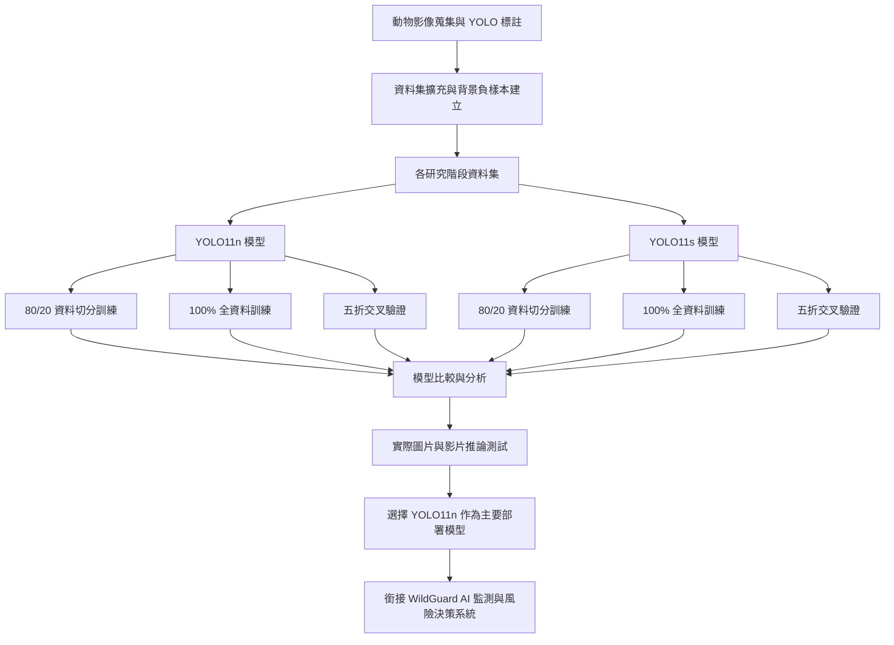

# 🐻 WildGuard AI：多物種智慧監測與生態風險決策平台

**WildGuard AI: Multi-Species Intelligent Monitoring and Ecological Risk Decision Platform**

本專題結合 **Edge AI、YOLO 物件偵測、風險分析、事件資料管理與生成式人工智慧（GenAI）**，以臺灣黑熊與綠鬣蜥作為主要應用案例，建立具備多物種擴充能力的智慧生態監測與風險決策支援平台。

系統以影像辨識為基礎，進一步整合事件紀錄、風險評估及自然語言互動等功能，期望將傳統野生動物監測由單純的影像辨識，延伸為具備即時監測、風險分析與管理輔助能力的智慧資訊服務。

> **專案說明：** 本 GitHub Repository 主要展示 WildGuard AI 整體專題架構，以及本人負責之 YOLO 物件偵測模組的研究、資料集建置、模型訓練、效能評估與優化成果。整體平台其他功能依實際開發進度逐步整合。

---

# 🌍 一、前言（Introduction）

近年來，隨著人類生活空間與野生動物棲地逐漸重疊，野生動物進入農田、果園、部落及住宅周邊的情況，逐漸成為生態保育與公共安全管理的重要議題。

以臺灣黑熊為例，當黑熊出現在部落、工寮或果園附近時，可能增加人獸接觸與衝突風險；而綠鬣蜥作為外來入侵種，可能造成農作物損失及生態環境管理負擔。

傳統野生動物監測方式多仰賴紅外線相機、人工巡查及事後影像判讀，不僅需要投入大量人力，也難以及時掌握動物出沒情形及潛在風險。

因此，本專題提出 **WildGuard AI：多物種智慧監測與生態風險決策平台**，透過人工智慧影像辨識與資訊系統整合，提升野生動物監測的即時性與管理效率。

本研究以 YOLO 物件偵測技術作為系統的視覺辨識核心，並結合事件紀錄、風險評估與生成式人工智慧，將影像偵測結果轉換為可供管理者參考的資訊。

專題的核心概念為：

**Detection（物件偵測）→ Risk Analysis（風險分析）→ Decision Support（決策支援）**

透過此架構，WildGuard AI 不再侷限於辨識動物是否出現，而是朝向可持續擴充物種、應用場域與管理服務的智慧生態平台發展。

---

# 💡 二、創意描述（Innovation Description）

## 2.1 從單一物種辨識延伸至多物種智慧監測

WildGuard AI 的設計理念並非僅針對單一物種建立辨識模型，而是希望建構具備擴充能力的多物種監測平台。

本專題以臺灣黑熊與綠鬣蜥作為兩種不同管理需求的代表案例。

- **臺灣黑熊：** 著重人獸衝突、公共安全與高風險事件預警。
- **綠鬣蜥：** 著重外來入侵種監測、群聚數量、農地入侵及分布趨勢。

透過共用影像偵測、事件資料與風險分析架構，未來新增其他物種時，可依照物種特性調整辨識模型及風險設定，降低重新開發整套系統的需求。

## 2.2 物種感知風險分析（Species-aware Risk Engine）

傳統物件偵測模型主要提供物件類別、位置及信心分數，但不同動物的出現，所代表的風險程度並不相同。

因此，本專題設計物種感知風險分析機制，依照不同事件的特性進行量化評估。

主要風險因子包含：

| 風險因子 | 代號 | 說明 |
|---|---|---|
| Species | S | 物種風險 |
| Environment | E | 出沒環境 |
| Distance | D | 目標距離 |
| Number | N | 物種數量 |
| Frequency | F | 近期出現頻率 |
| Time | T | 出沒時間 |

系統以 **0–100 分**作為風險評估範圍，並依照分數提供不同風險等級及管理建議。

例如，黑熊出現在住宅周邊與綠鬣蜥出現在農田，即使同樣是偵測到一隻動物，其管理需求與風險判斷方式仍有所不同。

透過物種感知風險分析，使系統能提供更符合實際情境的管理資訊。

## 2.3 時空熱區與出沒趨勢分析

為了讓監測資料不只停留在單次事件，本專題規劃將物種、時間、數量、風險分數及場域資訊整合至事件資料管理機制。

透過累積歷史事件，可進一步分析：

- 不同物種的出沒頻率。
- 特定場域的事件分布。
- 近期高風險事件。
- 7 日、14 日及 30 日的出沒趨勢。
- 可能需要優先巡查的區域。

此功能可作為未來 GIS 地圖視覺化與生態管理決策服務的發展基礎。

## 2.4 GenAI 自然語言決策輔助

WildGuard AI 整體系統結合生成式人工智慧，期望讓使用者以自然語言查詢監測事件與風險資訊。

例如：

- 最近七天哪個區域的綠鬣蜥最多？
- 今天是否出現高風險黑熊事件？
- 目前監測到哪些動物？
- 遇到黑熊時應採取哪些應對措施？

系統透過結合事件資料與 AI 模型分析，朝向具備資訊查詢、風險說明及處置建議能力的生態決策輔助服務發展。

## 2.5 多場域與物種擴充

WildGuard AI 的應用不侷限於單一監測場域。

未來可依照實際需求，延伸至山林巡護、部落預警、果園監測、農地外來種管理及河岸生態觀察等情境。

此外，YOLO 資料集亦持續擴充不同物種影像，作為後續模型研究與多物種辨識能力提升的基礎。

---

# ⚙️ 三、系統功能簡介（System Functions）

WildGuard AI 以 YOLO 影像偵測作為前端資料來源，並透過後端資訊系統整合風險分析、事件紀錄及生成式人工智慧服務。

整體功能規劃如下：

| 系統模組 | 主要功能 | 應用價值 |
|---|---|---|
| 多物種即時監測 | YOLO 辨識物種、數量、位置與信心分數 | 降低人工影像判讀需求 |
| 事件資料紀錄 | 儲存偵測時間、物種、數量及相關資訊 | 支援歷史事件查詢 |
| 風險量化分析 | 根據物種與環境等因子計算 Risk Score | 協助判斷事件優先程度 |
| 即時告警 | 依照風險門檻提供警示資訊 | 提升事件應變效率 |
| GenAI 自然語言服務 | 提供事件查詢、風險說明與管理建議 | 降低資訊使用門檻 |
| 時空熱區分析 | 整合歷史事件與場域資訊 | 支援巡查與管理規劃 |
| 物種擴充 | 新增辨識類別與風險設定 | 提升系統延展性 |

其中，**YOLO 物件偵測模組**負責從影像中取得物件辨識結果，作為後續事件紀錄及風險分析的重要資料來源。

部分進階服務仍依照專題開發進度持續整合與驗證。

---

# ✨ 四、系統特色（System Features）

## 4.1 多物種辨識與擴充能力

本專題的 YOLO 物件偵測研究初期由三類別開始，逐步擴充至六類別，並進一步增加綠鬣蜥與台灣水鹿，建立八類別多物種影像資料集。

原始六類別包含：

| Class ID | 英文名稱 | 中文名稱 |
|---:|---|---|
| 0 | Dog | 狗 |
| 1 | Cat | 貓 |
| 2 | Bear | 台灣黑熊 |
| 3 | Pig | 豬 |
| 4 | Monkey | 台灣獼猴 |
| 5 | Person | 人 |

後續擴充新增兩種類別：

| Class ID | 英文名稱 | 中文名稱 |
|---:|---|---|
| 6 | Iguana | 綠鬣蜥 |
| 7 | Deer | 台灣水鹿 |

此外，本研究亦加入不同光線與自然環境條件下的背景負樣本，協助模型學習無目標物件的場景特徵，作為降低誤判及持續優化辨識能力的基礎。

**背景負樣本不屬於正式偵測類別，因此不另設 Class ID。**

隨著資料集逐步擴充，本研究使用 **YOLO11n 與 YOLO11s** 進行不同階段的模型訓練與比較，並透過多種訓練策略及實際影像測試，持續改善多物種辨識能力。

最終考量 WildGuard AI 的邊緣運算部署需求，選擇 **YOLO11n 作為主要物件偵測模型**，並保留 YOLO11s 作為研究比較模型，以展現系統在物種辨識與模型擴充上的應用潛力。

## 4.2 邊緣運算與即時監測

系統採用 Edge AI 概念，透過 NVIDIA Jetson 等邊緣運算設備執行 YOLO 影像推論。

相較於完全仰賴雲端影像處理，邊緣運算可讓前端設備先完成物件辨識，再依需求將事件資訊傳送至後端系統。

此方式可作為野外監測及即時警示應用的技術基礎。

## 4.3 物種差異化風險分析

不同物種的管理需求有所差異。

WildGuard AI 透過物種風險、出沒環境、距離、數量、頻率及時間等因子，建立可調整的風險分析架構。

以黑熊與綠鬣蜥為例，前者著重公共安全與人獸衝突，後者則著重數量、群聚及農業環境影響。

## 4.4 背景負樣本與誤判改善

自然環境中的岩石、樹木、草叢及陰影，可能對物件偵測造成干擾。

因此，本研究除蒐集目標物種影像外，也建立背景負樣本資料，協助模型學習無目標物件的場景特徵。

背景負樣本包含不同光線及環境條件，以支援後續模型誤判分析與優化。

## 4.5 模型比較與研究驗證

本研究使用 **YOLO11n 與 YOLO11s** 作為主要研究模型，並分別採用 **80/20 資料切分、100% 全資料訓練及五折交叉驗證** 三種策略，進行多類別物件偵測研究。

研究重點包含：

- 不同模型規模的辨識能力與運算需求。
- 資料集擴充對模型表現的影響。
- 多類別物件偵測與分類能力。
- 背景負樣本對自然環境誤判的影響。
- 不同訓練與驗證策略的應用特性。
- 實際圖片與影片推論測試。

透過模型比較、交叉驗證及獨立影像測試，作為模型優化與部署選擇的參考，最終選擇 **YOLO11n 作為 WildGuard AI 的主要物件偵測模型**。

# 🛠️ 五、系統開發工具與技術（Development Tools and Technologies）

WildGuard AI 整合電腦視覺、邊緣運算、後端系統及生成式人工智慧等技術。

| 技術層級 | 開發工具與技術 |
|---|---|
| 物件偵測 | YOLO11n、YOLO11s、Ultralytics |
| 深度學習 | PyTorch |
| 資料標註 | Label Studio、YOLO Annotation Format |
| 邊緣運算 | NVIDIA Jetson |
| 程式語言 | Python |
| 後端服務 | FastAPI、HTTP API、JSON |
| 生成式人工智慧 | Breeze 2 3B、Qwen 2.5 3B |
| 模型訓練與驗證 | 80/20 Train/Validation Split、100% Full-Dataset Training、5-Fold Cross Validation |
| 效能評估 | Precision、Recall、mAP50、mAP50-95 |
| 網頁介面與資料視覺化 | Web Dashboard、監測事件管理、風險資訊視覺化 |
| 地理資訊與趨勢分析 | GIS 地圖、出沒熱區與歷史趨勢分析（依實際完成進度） |

不同技術分屬整體系統或 YOLO 研究模組，並非全部包含於本 Repository。

---

# 👥 六、系統使用對象（Target Users）

WildGuard AI 主要面向具有野生動物監測、公共安全及生態管理需求的使用者。

包括：

- 林業與自然保育相關單位。
- 第一線巡山與野生動物巡護人員。
- 地方政府及生態管理單位。
- 農業管理及外來種移除人員。
- 野生動物與生態研究人員。
- 監測場域管理者。

透過即時辨識、事件紀錄及風險分析，期望協助管理者提升監測效率，並將監測結果轉換為更具參考價值的資訊。

---

# 🌲 七、系統使用環境（Deployment Environment）

WildGuard AI 可依照實際應用需求，部署於臺灣淺山、森林、部落周邊、果園、農地及河岸等場域。

前端可使用攝影機搭配 NVIDIA Jetson 進行影像辨識，將偵測到的物種、數量、時間及相關資訊傳送至後端。

後端系統則負責事件資料整合、風險分析與管理介面服務。

系統可依照現場網路條件，採用既有網路、4G／5G 或其他適合的通訊方式。

實際部署方式仍需考量設備效能、網路穩定性、供電條件及監測環境。

---

# 🎯 八、結語（Conclusion）

WildGuard AI 的核心理念，是將野生動物監測由傳統影像辨識，延伸至具備多物種監測、風險分析與決策支援能力的智慧資訊服務。

本專題以臺灣黑熊與綠鬣蜥作為主要應用案例，透過不同物種的管理需求，展現系統在物種辨識、事件紀錄、風險規則與應用場域上的擴充潛力。

其中，YOLO 物件偵測模組為整體系統提供重要的視覺辨識基礎。

透過資料集建置、模型比較、五折交叉驗證與持續優化，本研究逐步累積多類別物件偵測的實作經驗，並將研究成果應用於智慧生態監測情境。

未來將持續強化模型在不同場景中的辨識能力，並逐步整合風險決策、事件分析及多物種管理服務，使 WildGuard AI 朝向更完整且具實際應用價值的生態監測平台發展。

---

# 🧑‍💻 九、個人負責項目與 YOLO 研究成果（Personal Contributions & YOLO Research）

## 9.1 個人負責項目

本人於 WildGuard AI 專題中，主要負責 **YOLO 物件偵測模組的研究、開發與模型優化**。

主要工作包含：

- 物件偵測影像資料蒐集與整理。
- 使用 Label Studio 進行影像標註。
- 建立 YOLO 格式影像與標註資料集。
- YOLO11n 與 YOLO11s 模型訓練及比較。
- 80/20 資料切分、100% 全資料訓練及五折交叉驗證。
- 模型效能評估、參數調整與最佳權重選擇。
- 背景負樣本擴充與誤判、漏判分析。
- 實際圖片與影片推論測試。
- 持續擴充多物種影像資料集。
- 配合整體系統進行 YOLO 偵測結果整合。

本 GitHub Repository 主要用於記錄上述研究歷程、資料集建置、模型訓練與相關實驗成果。

## 9.2 YOLO 模型研究與資料集擴充歷程

本研究從初期動物影像資料蒐集與標註開始，逐步擴充辨識類別、影像數量及背景負樣本，並使用 **YOLO11n 與 YOLO11s** 進行不同階段的模型訓練與比較，建立適用於 WildGuard AI 的多物種物件偵測研究基礎。

### 資料集發展歷程

| 研究階段 | 辨識類別 | 影像數量 | 研究重點 |
|---|---|---|---|
| 第一階段 | 三類別：狗、貓、黑熊 | 300 張 | 建立初期物件偵測資料集 |
| 第二階段 | 三類別：狗、貓、黑熊 | 450 張 | 增加影像數量與樣本多樣性 |
| 第三階段 | 擴充至六類別 | 750 張 | 新增豬、猴、人三種類別 |
| 第四階段 | 六類別 | 900 張 | 擴充各類別影像數量 |
| 第五階段 | 六類別及背景負樣本 | 1,050 張 | 新增 150 張背景負樣本 |
| 第六階段 | 擴充至八類別及背景負樣本 | 2,200 張 | 新增綠鬣蜥、台灣水鹿，並擴充其他物種及背景影像 |

隨著資料集逐步擴充，本研究由初期的**三類別辨識**，發展至六類別及八類別多物種物件偵測，並以台灣黑熊與綠鬣蜥作為 WildGuard AI 的主要應用案例。

不同研究階段使用的資料集規模與類別數量有所差異，相關模型訓練與驗證方式將於後續章節說明。

### 最新八類別資料集

本研究目前建立包含 **八種辨識類別及背景負樣本**的影像資料集，共計 **2,200 張影像**，其中目標物種與人員影像為 2,000 張，背景負樣本為 200 張。

| Class ID | 類別 | 影像數量 |
|---|---|---:|
| 0 | Dog（狗） | 200 |
| 1 | Cat（貓） | 200 |
| 2 | Bear（台灣黑熊） | 400 |
| 3 | Pig（豬） | 200 |
| 4 | Monkey（台灣獼猴） | 200 |
| 5 | Person（人） | 200 |
| 6 | Iguana（綠鬣蜥） | 400 |
| 7 | Deer（台灣水鹿） | 200 |
| — | Background（背景負樣本） | 200 |
| **合計** | **八類別及背景負樣本** | **2,200** |

背景負樣本不屬於正式辨識類別，因此不設定 Class ID，主要用於協助模型學習無目標物件的自然環境特徵，作為降低背景誤判及提升辨識穩定性的訓練資料。

### 模型研究歷程

在資料集逐步擴充的過程中，本研究使用 **YOLO11n 與 YOLO11s** 進行多類別物件偵測研究，並分別採用 **80/20 資料切分、100% 全資料訓練及五折交叉驗證** 三種訓練策略。

其中，80/20 資料切分用於模型訓練與驗證，100% 全資料訓練用於充分利用可用影像進行模型訓練，五折交叉驗證則用於觀察模型在不同資料切分下的表現與穩定性。

透過不同模型規模、訓練策略及實際圖片與影片推論測試，分析模型在多物種辨識任務中的應用特性，並綜合考量 WildGuard AI 的邊緣運算需求，最終選擇 **YOLO11n 作為主要物件偵測模型**，保留 YOLO11s 作為研究比較模型。

## 9.3 YOLO11n 與 YOLO11s 模型訓練策略

本研究以 **YOLO11n 與 YOLO11s** 作為物件偵測模型的研究對象，透過不同模型規模及訓練策略，分析其在多類別物件偵測任務中的應用特性。

為建立完整的模型研究流程，兩種模型分別採用以下三種訓練策略：

| 訓練策略 | YOLO11n | YOLO11s | 研究目的 |
|---|---|---|---|
| 80/20 資料切分訓練 | ✓ | ✓ | 將資料集依比例分為訓練集與驗證集，評估模型辨識表現 |
| 100% 全資料訓練 | ✓ | ✓ | 使用全部可用影像進行訓練，不額外保留獨立驗證集 |
| 五折交叉驗證 | ✓ | ✓ | 透過五組不同的訓練與驗證資料切分，觀察模型表現與穩定性 |

不同研究階段使用的資料集版本與影像數量可能有所差異，因此上述訓練策略不代表所有實驗均使用相同規模的資料集。

### 統一訓練設定

為維持研究設定的一致性，**各模型在不同訓練策略中採用相同的主要參數設定**，並依模型特性保留不同的損失函數權重。

| 訓練參數 | YOLO11n | YOLO11s |
|---|---|---|
| Epochs | 100 | 100 |
| Batch Size | 8 | 8 |
| Image Size | 640 × 640 | 640 × 640 |
| Optimizer | Auto | Auto |
| Classification Loss（cls） | 0.75 | 0.745 |
| Box Loss（box） | Ultralytics 預設值 | 8.0 |
| Cosine Learning Rate | True | True |
| Close Mosaic | 10 | 10 |
| AMP | True | True |
| Workers | 2 | 2 |
| Seed | 42 | 42 |
| Deterministic | True | True |

上述參數為本研究所採用的主要訓練設定，實際執行結果仍會受到資料集版本、模型規模及訓練環境等因素影響。

### 自動化資料集處理

為因應多物種資料集持續擴充的需求，本研究逐步建立資料集處理流程，包括影像數量統計、正樣本與背景負樣本整理、訓練資料夾建立及標註檔案檢查。

其中，80/20 資料切分訓練依比例建立訓練集與驗證集；100% 全資料訓練則使用全部可用影像進行模型訓練，不額外保留獨立驗證集。

目前 **YOLO11n 的全資料訓練程式已具備自動統計影像數量及建立訓練資料的功能**；YOLO11s 的非五折訓練程式則規劃進一步調整為自動統計與自動切分版本，以減少資料集擴充時需要手動修改影像數量及資料切分設定的情況。

後續將持續完善資料集自動化處理流程，提高模型訓練程式的維護性與擴充便利性。

## 9.4 YOLO11n 與 YOLO11s 模型比較及選擇

本研究除了進行不同資料切分方式的實驗，也針對 YOLO11n 與 YOLO11s 的模型特性進行比較，作為 WildGuard AI 物件偵測模組的選型依據。

**YOLO11n** 屬於輕量化模型，運算資源需求較低，適合應用於 NVIDIA Jetson 等邊緣運算設備。

**YOLO11s** 具有較大的模型規模，可作為辨識能力與運算需求的比較對象。

研究過程除透過模型訓練與交叉驗證進行分析，也搭配實際圖片及影片推論，觀察不同模型在自然環境、光線變化及目標距離等條件下的辨識情況。

考量 WildGuard AI 需要整合即時影像辨識、風險分析與預警功能，並部署於運算資源有限的邊緣設備，最終選擇 **YOLO11n 作為主要物件偵測模型**，YOLO11s 則保留作為研究比較模型。

本 README 以研究方法、實作流程及模型選擇為主要介紹內容，不逐一列出各次實驗的詳細效能數據。

## 9.5 獨立影像與影片測試

為評估 YOLO11n 與 YOLO11s 在實際應用情境中的辨識能力，本研究使用未參與模型訓練及五折交叉驗證的獨立影像與影片進行推論測試，觀察模型面對不同環境條件與新資料時的辨識表現。

測試重點包含：

- **目標偵測能力：** 是否能成功偵測影像中的動物或人員。
- **類別辨識正確性：** 是否能正確區分不同物種。
- **邊界框準確性：** Bounding Box 是否合理涵蓋目標物件。
- **辨識信心分數：** 觀察 Confidence Score 的變化。
- **環境適應能力：** 測試遠距離、不同光線及複雜自然環境下的辨識情況。
- **誤判與漏判分析：** 觀察背景干擾、錯誤分類及未成功偵測的情況。

透過獨立影像與影片測試，作為模型辨識問題分析、參數調整及最終部署模型選擇的參考，並持續改善 WildGuard AI 在真實監測環境中的應用能力。

## 9.6 YOLO 模型研究流程

本研究從資料集建立、影像標註、模型訓練與比較，到主要部署模型選擇，建立多類別物件偵測研究流程。

### 研究流程說明

本研究首先進行動物影像蒐集與 YOLO 格式標註，並逐步增加辨識類別、背景負樣本及不同環境條件下的影像，建立不同研究階段的多物種資料集。

接著使用 **YOLO11n 與 YOLO11s**，分別進行 **80/20 資料切分訓練、100% 全資料訓練及五折交叉驗證**，建立不同模型與訓練策略的研究基礎。

完成模型訓練後，透過獨立圖片及影片推論測試，觀察模型在不同環境條件下的辨識情況，並綜合考量模型規模與邊緣運算設備的資源需求，最終選擇 **YOLO11n 作為 WildGuard AI 的主要物件偵測模型**。

後續將持續強化 YOLO 偵測模組與 WildGuard AI 監測平台的整合，並逐步完善物種風險分析、事件管理及預警功能，提升系統在野生動物監測情境中的應用價值。

# 🚀 十、未來研究與發展方向（Future Work）

WildGuard AI 未來將持續朝向多物種辨識、模型效能優化、邊緣運算應用及智慧生態風險決策支援等方向發展。

主要研究方向包含：

1. **多物種模型訓練與驗證：** 以目前建立的八類別、2,200 張影像資料集為基礎，持續進行 YOLO11n 與 YOLO11s 模型訓練、參數優化及效能評估，分析不同物種、光線及自然環境條件下的辨識表現。
2. **背景誤判與漏判改善：** 持續擴充背景負樣本及實際誤判案例，分析模型在複雜自然環境中的辨識問題，提升物種偵測的穩定性。
3. **邊緣運算與即時推論優化：** 持續評估 YOLO 模型在 NVIDIA Jetson 等邊緣運算設備上的推論效能，改善即時監測的運算效率與應用可行性。
4. **風險決策與事件管理整合：** 持續完善物種辨識、事件紀錄、風險分數計算及差異化預警機制，提升系統對不同物種與監測情境的決策支援能力。
5. **網頁監測與時空資料視覺化：** 在既有網頁監測與風險資訊視覺化功能的基礎上，持續擴充歷史事件查詢、物種出沒趨勢、GIS 地圖及熱區分析能力。
6. **GenAI 自然語言互動服務：** 持續強化 Breeze 2 3B 與 Qwen 2.5 3B 的應用整合，提升監測事件查詢、風險資訊解釋及管理建議的實用性。

期望透過持續研究、模型優化與系統整合，讓 WildGuard AI 由專題實作逐步發展為具備多物種擴充能力、即時監測及生態風險決策支援能力的智慧資訊平台。

---

**WildGuard AI — From Detection to Decision Support**

*由物件偵測延伸至智慧生態風險決策支援。*
