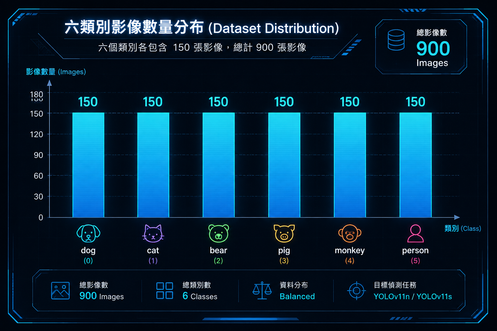
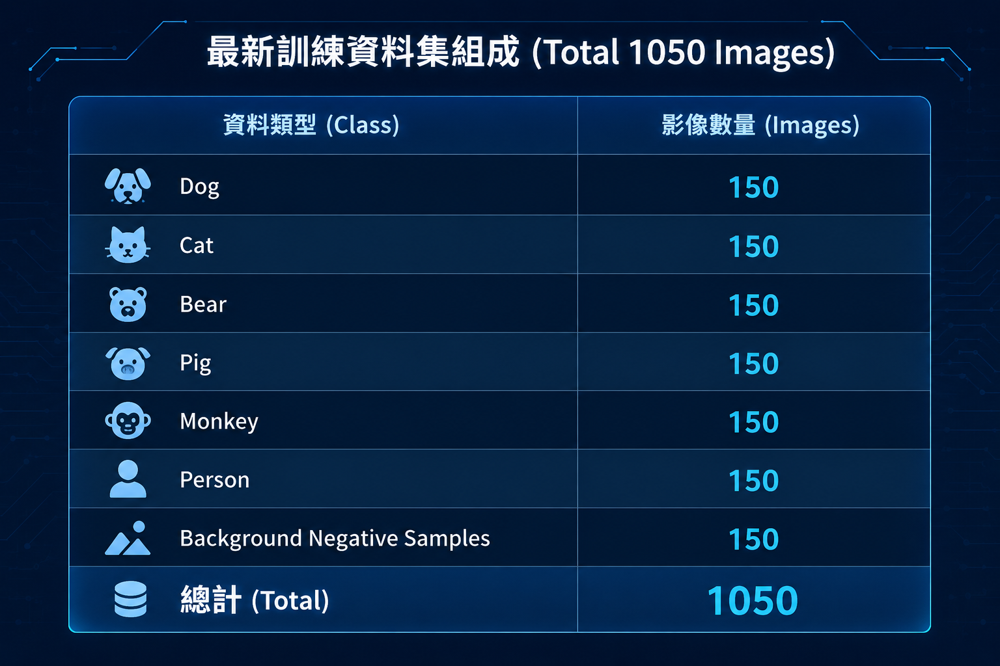
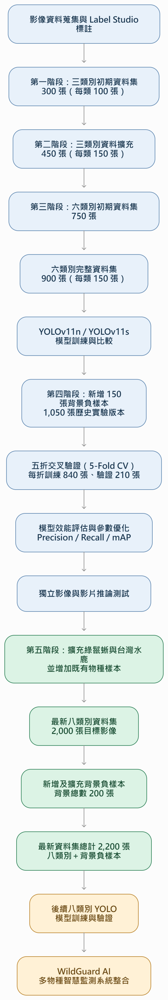

# 🐻 WildGuard AI：多物種智慧監測與生態風險決策平台

**WildGuard AI: Multi-Species Intelligent Monitoring and Ecological Risk Decision Platform**

本專題結合 **Edge AI、YOLO 物件偵測、風險分析、事件資料管理與生成式人工智慧（GenAI）**，以臺灣黑熊與綠鬣蜥作為主要應用案例，建立具備多物種擴充能力的智慧生態監測與風險決策支援平台。

系統以影像辨識為基礎，進一步整合事件紀錄、風險評估及自然語言互動等功能，期望將傳統野生動物監測由單純的影像辨識，延伸為具備即時監測、風險分析與管理輔助能力的智慧資訊服務。

> **專案說明：** 本 GitHub Repository 主要展示 WildGuard AI 整體專題架構，以及本人負責之 YOLO 物件偵測模組的研究、資料集建置、模型訓練、效能評估與優化成果。整體平台其他功能依實際開發進度逐步整合。

---

# 🌍 一、前言（Introduction）

近年來，隨著人類生活空間與野生動物棲地逐漸重疊，野生動物進入農田、果園、部落及住宅周邊的情況，逐漸成為生態保育與公共安全管理的重要議題。

以臺灣黑熊為例，當黑熊出現在部落、工寮或果園附近時，可能增加人獸接觸與衝突風險；而綠鬣蜥作為外來入侵種，可能造成農作物損失及生態環境管理負擔。

傳統野生動物監測方式多仰賴紅外線相機、人工巡查及事後影像判讀，不僅需要投入大量人力，也難以及時掌握動物出沒情形及潛在風險。

因此，本專題提出 **WildGuard AI：多物種智慧監測與生態風險決策平台**，透過人工智慧影像辨識與資訊系統整合，提升野生動物監測的即時性與管理效率。

本研究以 YOLO 物件偵測技術作為系統的視覺辨識核心，並結合事件紀錄、風險評估與生成式人工智慧，將影像偵測結果轉換為可供管理者參考的資訊。

專題的核心概念為：

**Detection（物件偵測）→ Risk Analysis（風險分析）→ Decision Support（決策支援）**

透過此架構，WildGuard AI 不再侷限於辨識動物是否出現，而是朝向可持續擴充物種、應用場域與管理服務的智慧生態平台發展。

---

# 💡 二、創意描述（Innovation Description）

## 2.1 從單一物種辨識延伸至多物種智慧監測

WildGuard AI 的設計理念並非僅針對單一物種建立辨識模型，而是希望建構具備擴充能力的多物種監測平台。

本專題以臺灣黑熊與綠鬣蜥作為兩種不同管理需求的代表案例。

- **臺灣黑熊：** 著重人獸衝突、公共安全與高風險事件預警。
- **綠鬣蜥：** 著重外來入侵種監測、群聚數量、農地入侵及分布趨勢。

透過共用影像偵測、事件資料與風險分析架構，未來新增其他物種時，可依照物種特性調整辨識模型及風險設定，降低重新開發整套系統的需求。

## 2.2 物種感知風險分析（Species-aware Risk Engine）

傳統物件偵測模型主要提供物件類別、位置及信心分數，但不同動物的出現，所代表的風險程度並不相同。

因此，本專題設計物種感知風險分析機制，依照不同事件的特性進行量化評估。

主要風險因子包含：

| 風險因子 | 代號 | 說明 |
|---|---|---|
| Species | S | 物種風險 |
| Environment | E | 出沒環境 |
| Distance | D | 目標距離 |
| Number | N | 物種數量 |
| Frequency | F | 近期出現頻率 |
| Time | T | 出沒時間 |

系統以 **0–100 分**作為風險評估範圍，並依照分數提供不同風險等級及管理建議。

例如，黑熊出現在住宅周邊與綠鬣蜥出現在農田，即使同樣是偵測到一隻動物，其管理需求與風險判斷方式仍有所不同。

透過物種感知風險分析，使系統能提供更符合實際情境的管理資訊。

## 2.3 時空熱區與出沒趨勢分析

為了讓監測資料不只停留在單次事件，本專題規劃將物種、時間、數量、風險分數及場域資訊整合至事件資料管理機制。

透過累積歷史事件，可進一步分析：

- 不同物種的出沒頻率。
- 特定場域的事件分布。
- 近期高風險事件。
- 7 日、14 日及 30 日的出沒趨勢。
- 可能需要優先巡查的區域。

此功能可作為未來 GIS 地圖視覺化與生態管理決策服務的發展基礎。

## 2.4 GenAI 自然語言決策輔助

WildGuard AI 整體系統結合生成式人工智慧，期望讓使用者以自然語言查詢監測事件與風險資訊。

例如：

- 最近七天哪個區域的綠鬣蜥最多？
- 今天是否出現高風險黑熊事件？
- 目前監測到哪些動物？
- 遇到黑熊時應採取哪些應對措施？

系統透過結合事件資料與 AI 模型分析，朝向具備資訊查詢、風險說明及處置建議能力的生態決策輔助服務發展。

## 2.5 多場域與物種擴充

WildGuard AI 的應用不侷限於單一監測場域。

未來可依照實際需求，延伸至山林巡護、部落預警、果園監測、農地外來種管理及河岸生態觀察等情境。

此外，YOLO 資料集亦持續擴充不同物種影像，作為後續模型研究與多物種辨識能力提升的基礎。

---

# ⚙️ 三、系統功能簡介（System Functions）

WildGuard AI 以 YOLO 影像偵測作為前端資料來源，並透過後端資訊系統整合風險分析、事件紀錄及生成式人工智慧服務。

整體功能規劃如下：

| 系統模組 | 主要功能 | 應用價值 |
|---|---|---|
| 多物種即時監測 | YOLO 辨識物種、數量、位置與信心分數 | 降低人工影像判讀需求 |
| 事件資料紀錄 | 儲存偵測時間、物種、數量及相關資訊 | 支援歷史事件查詢 |
| 風險量化分析 | 根據物種與環境等因子計算 Risk Score | 協助判斷事件優先程度 |
| 即時告警 | 依照風險門檻提供警示資訊 | 提升事件應變效率 |
| GenAI 自然語言服務 | 提供事件查詢、風險說明與管理建議 | 降低資訊使用門檻 |
| 時空熱區分析 | 整合歷史事件與場域資訊 | 支援巡查與管理規劃 |
| 物種擴充 | 新增辨識類別與風險設定 | 提升系統延展性 |

其中，**YOLO 物件偵測模組**負責從影像中取得物件辨識結果，作為後續事件紀錄及風險分析的重要資料來源。

部分進階服務仍依照專題開發進度持續整合與驗證。

---

# ✨ 四、系統特色（System Features）

## 4.1 多物種辨識與擴充能力

本專題的 YOLO 研究初期由三類別開始，逐步擴充至六類別，並持續增加其他物種資料。

原始六類別包含：

| Class ID | 英文名稱 | 中文名稱 |
|---:|---|---|
| 0 | Dog | 狗 |
| 1 | Cat | 貓 |
| 2 | Bear | 熊 |
| 3 | Pig | 豬 |
| 4 | Monkey | 猴 |
| 5 | Person | 人 |

後續擴充資料集新增：

| Class ID | 英文名稱 | 中文名稱 |
|---:|---|---|
| 6 | Iguana | 綠鬣蜥 |
| 7 | Deer | 台灣水鹿 |

此外，亦持續新增背景負樣本，以改善模型在自然環境中的誤判問題。

**背景負樣本不屬於正式偵測類別，因此不另設 Class ID。**

需要注意的是，資料集擴充不等同於模型已完成對應類別的重新訓練。原始六類別模型與後續八類資料集的研究階段分別記錄。

## 4.2 邊緣運算與即時監測

系統採用 Edge AI 概念，透過 NVIDIA Jetson 等邊緣運算設備執行 YOLO 影像推論。

相較於完全仰賴雲端影像處理，邊緣運算可讓前端設備先完成物件辨識，再依需求將事件資訊傳送至後端系統。

此方式可作為野外監測及即時警示應用的技術基礎。

## 4.3 物種差異化風險分析

不同物種的管理需求有所差異。

WildGuard AI 透過物種風險、出沒環境、距離、數量、頻率及時間等因子，建立可調整的風險分析架構。

以黑熊與綠鬣蜥為例，前者著重公共安全與人獸衝突，後者則著重數量、群聚及農業環境影響。

## 4.4 背景負樣本與誤判改善

自然環境中的岩石、樹木、草叢及陰影，可能對物件偵測造成干擾。

因此，本研究除蒐集目標物種影像外，也建立背景負樣本資料，協助模型學習無目標物件的場景特徵。

背景負樣本包含不同光線及環境條件，以支援後續模型誤判分析與優化。

## 4.5 模型比較與研究驗證

本研究使用 YOLOv11n 與 YOLOv11s 作為主要比較對象，並透過五折交叉驗證與模型效能指標進行分析。

研究重點包含：

- 不同模型規模的辨識效能。
- 資料量擴充對模型表現的影響。
- 多類別辨識能力。
- 背景負樣本對誤判的影響。
- 不同推論參數對偵測結果的影響。

---

# 🛠️ 五、系統開發工具與技術（Development Tools and Technologies）

WildGuard AI 整合電腦視覺、邊緣運算、後端系統及生成式人工智慧等技術。

| 技術層級 | 開發工具與技術 |
|---|---|
| 物件偵測 | YOLOv11n、YOLOv11s、Ultralytics |
| 深度學習 | PyTorch |
| 資料標註 | Label Studio、YOLO Annotation Format |
| 邊緣運算 | NVIDIA Jetson |
| 程式語言 | Python |
| 後端服務 | FastAPI、HTTP API、JSON |
| 生成式人工智慧 | Breeze 2 3B、Qwen 2.5 3B |
| 模型驗證 | 5-Fold Cross Validation |
| 效能評估 | Precision、Recall、mAP50、mAP50-95 |
| 資料與視覺化 | 事件資料管理、GIS 與熱區分析規劃 |

不同技術分屬整體系統或 YOLO 研究模組，並非全部包含於本 Repository。

---

# 👥 六、系統使用對象（Target Users）

WildGuard AI 主要面向具有野生動物監測、公共安全及生態管理需求的使用者。

包括：

- 林業與自然保育相關單位。
- 第一線巡山與野生動物巡護人員。
- 地方政府及生態管理單位。
- 農業管理及外來種移除人員。
- 野生動物與生態研究人員。
- 監測場域管理者。

透過即時辨識、事件紀錄及風險分析，期望協助管理者提升監測效率，並將監測結果轉換為更具參考價值的資訊。

---

# 🌲 七、系統使用環境（Deployment Environment）

WildGuard AI 可依照實際應用需求，部署於臺灣淺山、森林、部落周邊、果園、農地及河岸等場域。

前端可使用攝影機搭配 NVIDIA Jetson 進行影像辨識，將偵測到的物種、數量、時間及相關資訊傳送至後端。

後端系統則負責事件資料整合、風險分析與管理介面服務。

系統可依照現場網路條件，採用既有網路、4G／5G 或其他適合的通訊方式。

實際部署方式仍需考量設備效能、網路穩定性、供電條件及監測環境。

---

# 🎯 八、結語（Conclusion）

WildGuard AI 的核心理念，是將野生動物監測由傳統影像辨識，延伸至具備多物種監測、風險分析與決策支援能力的智慧資訊服務。

本專題以臺灣黑熊與綠鬣蜥作為主要應用案例，透過不同物種的管理需求，展現系統在物種辨識、事件紀錄、風險規則與應用場域上的擴充潛力。

其中，YOLO 物件偵測模組為整體系統提供重要的視覺辨識基礎。

透過資料集建置、模型比較、五折交叉驗證與持續優化，本研究逐步累積多類別物件偵測的實作經驗，並將研究成果應用於智慧生態監測情境。

未來將持續強化模型在不同場景中的辨識能力，並逐步整合風險決策、事件分析及多物種管理服務，使 WildGuard AI 朝向更完整且具實際應用價值的生態監測平台發展。

---

# 🧑‍💻 九、個人負責項目與 YOLO 研究成果（Personal Contributions & YOLO Research）

## 9.1 個人負責項目

本人於 WildGuard AI 專題中，主要負責 **YOLO 物件偵測模組的研究、開發與模型優化**。

主要工作包含：

- 物件偵測影像資料蒐集與整理。
- 使用 Label Studio 進行影像標註。
- 建立 YOLO 格式影像與標註資料集。
- YOLOv11n 與 YOLOv11s 模型訓練。
- 五折交叉驗證與效能比較。
- 模型參數調整與最佳權重選擇。
- 背景負樣本擴充與誤判分析。
- 實際圖片與影片推論測試。
- 持續擴充多物種影像資料集。
- 配合整體系統進行 YOLO 偵測結果整合。

本 GitHub Repository 主要用於記錄上述研究歷程、資料集與相關實驗成果。

## 9.2 YOLO 研究歷程

本研究由三類別物件偵測開始，逐步增加資料量與辨識類別，並進一步進行模型比較及優化。

### 第一階段：三類別初期模型

初期選擇 Dog、Cat、Bear 三種類別，每類 100 張，共計 300 張影像。

| 類別 | 影像數量 |
|---|---:|
| Dog | 100 |
| Cat | 100 |
| Bear | 100 |
| **總計** | **300** |

此階段主要建立資料蒐集、標註、模型訓練與效能評估流程。

### 第二階段：三類別資料量擴充

將每個類別由 100 張增加至 150 張，使資料集擴充至 450 張。

| 類別 | 初期資料量 | 擴充後 |
|---|---:|---:|
| Dog | 100 | 150 |
| Cat | 100 | 150 |
| Bear | 100 | 150 |
| **總計** | **300** | **450** |

透過不同資料量的實驗，分析增加訓練樣本對模型辨識效能的影響。

在三類別研究階段，YOLOv11n 完成初期訓練與評估後，研究方向逐漸轉向六類別辨識，因此未另外建立三類別 YOLOv11n 優化版本。

YOLOv11s 則保留三類別模型優化研究，作為後續參數調整的參考。

### 第三階段：六類別資料集建立

新增 Pig、Monkey、Person 三種類別，將原本三類別擴充為六類別。

| 實驗階段 | Dog | Cat | Bear | Pig | Monkey | Person | 總數 |
|---|---:|---:|---:|---:|---:|---:|---:|
| 六類別初期 | 150 | 150 | 150 | 100 | 100 | 100 | 750 |
| 六類別完整 | 150 | 150 | 150 | 150 | 150 | 150 | 900 |

六類別完整資料集包含每類 150 張影像，共計 900 張。

  

  <b>圖 1　六類別資料集影像數量分布</b>

透過建立數量均衡的資料集，降低不同類別影像數量差異對模型比較造成的影響。

### 第四階段：背景負樣本擴充

為改善模型在森林及自然環境中的背景誤判問題，於當時的六類別資料集加入 150 張背景負樣本。

其中：

- 白天背景：75 張。
- 夜晚背景：75 張。
- 六類別目標影像：900 張。
- 背景負樣本：150 張。
- 當階段總影像數：1050 張。

  

  <b>圖 2　六類別加背景負樣本之實驗資料集組成（1050 張）</b>

**注意：1050 張為該研究階段使用的資料集規模，並非目前持續擴充後的最新資料集總量。**

### 第五階段：八類別資料集擴充（2,200 張）

為提升 WildGuard AI 的多物種辨識能力，本研究在原有六類別的基礎上，新增綠鬣蜥（Iguana）及台灣水鹿（Deer），將資料集擴充至八類別。

考量臺灣黑熊與綠鬣蜥為本專題的核心監測物種，因此針對這兩種類別增加影像樣本數量，各建立 400 張影像；其餘六類別則各建立 200 張影像。

此外，為改善模型在自然環境中的背景誤判問題，額外加入 200 張背景負樣本。

目前資料集共包含 **八種類別、2,000 張目標影像及 200 張背景負樣本，合計 2,200 張影像**。

透過增加核心物種的影像數量，以及擴充不同環境、光線與拍攝角度的樣本，期望提升模型在多樣化場景中的辨識能力，並作為後續 YOLO 模型訓練、效能比較與系統整合的基礎。

### 9.3 模型訓練設定與資料驗證（Training Configuration & Validation）

本研究依照不同研究階段採用對應的資料切分與模型驗證方式。早期六類別研究透過五折交叉驗證分析 YOLOv11n 與 YOLOv11s 的辨識效能；後續八類別模型則採用固定隨機種子的 80% 訓練集與 20% 驗證集進行訓練。

#### 9.3.1 歷史研究：五折交叉驗證

在六類別加背景負樣本的 1,050 張實驗資料集中，本研究採用五折交叉驗證（5-Fold Cross Validation），將資料分成五個部分，每次使用其中四個部分進行模型訓練，其餘一個部分進行驗證。

主要設定如下：

| 參數 | 設定值 |
|---|---|
| Cross Validation | 5-Fold |
| n_splits | 5 |
| shuffle | True |
| random_state | 42 |
| Dataset Size | 1,050 |
| Training Images / Fold | 840 |
| Validation Images / Fold | 210 |

透過五次訓練與驗證，分析模型在不同資料切分下的效能與穩定性。

#### 9.3.2 最新研究：八類別 YOLO11n 模型訓練

為支援 WildGuard AI 的多物種監測需求，本研究進一步建立八類別資料集，包含 2,000 張目標影像及 200 張背景負樣本，共計 2,200 張。

最新 YOLO11n 訓練程式採用 80% Training 與 20% Validation 的資料切分方式，並使用固定隨機種子確保切分結果可重現。

| 項目 | 設定 |
|---|---|
| Model | YOLO11n |
| Classes | 8 |
| Epochs | 100 |
| Batch Size | 8 |
| Image Size | 640 × 640 |
| Optimizer | Auto |
| Classification Loss Weight | 0.75 |
| Cosine Learning Rate | True |
| Close Mosaic | 10 |
| AMP | True |
| Workers | 2 |
| Seed | 42 |
| Deterministic | True |

**資料集切分規劃：**

| 資料用途 | 目標影像 | 背景負樣本 | 總數 |
|---|---:|---:|---:|
| Training | 1,600 | 160 | 1,760 |
| Validation | 400 | 40 | 440 |
| **Total** | **2,000** | **200** | **2,200** |

本階段採用固定比例的訓練與驗證資料切分，與早期五折交叉驗證屬於不同實驗設定。後續將依照模型訓練結果，透過 Precision、Recall、mAP50 與 mAP50-95 等指標評估辨識效能。

## 9.4 YOLOv11n 與 YOLOv11s 模型比較

本研究以 YOLOv11n 與 YOLOv11s 為主要比較模型。

YOLOv11n 屬於較輕量化的模型，適合作為邊緣運算與資源受限設備的研究選項；YOLOv11s 則具有較大的模型規模，可用於比較不同模型容量對辨識表現的影響。

主要評估指標包含：

| 評估指標 | 說明 |
|---|---|
| Precision | 預測為目標的結果中，正確預測所占比例 |
| Recall | 實際目標中，被模型成功偵測的比例 |
| mAP50 | IoU = 0.50 條件下的平均精確度 |
| mAP50-95 | IoU 0.50 至 0.95 不同門檻下的平均精確度 |

除了數值指標，也透過實際圖片與影片推論，觀察模型的辨識結果、Bounding Box 定位、信心分數及誤判情況。

不同實驗版本的訓練結果應分別記錄，以避免將不同資料集或模型設定的效能混為一談。

## 9.5 獨立影像與影片測試

為觀察模型面對新影像時的實際辨識能力，本研究另外使用未參與模型訓練及五折交叉驗證的影像進行推論測試。

測試重點包含：

- 目標物件是否成功偵測。
- 物件類別是否正確。
- Bounding Box 是否合理。
- Confidence Score 表現。
- 遠距離與不同光線條件下的辨識能力。
- 自然背景造成的誤判情況。

透過獨立測試結果，作為模型參數調整與部署選擇的參考。

### 9.6 YOLO 研究流程

本研究以多類別物件偵測為核心，從初期三類別資料集逐步擴充至六類別，並透過 YOLOv11n 與 YOLOv11s 模型訓練、五折交叉驗證及參數優化，評估不同模型與資料集設定下的辨識效能。

為支援 WildGuard AI 的多物種監測需求，後續新增綠鬣蜥與台灣水鹿，並持續擴充既有物種及背景負樣本。目前資料集包含 **八類別、2,000 張目標影像及 200 張背景負樣本，總計 2,200 張**，作為後續模型訓練、效能評估與系統整合的基礎。

  

  <b>圖 4　YOLO 研究歷程與資料集擴充流程圖</b>

# 🚀 十、未來研究與發展方向（Future Work）

WildGuard AI 未來將持續朝向多物種辨識、模型優化及智慧決策支援發展。

主要研究方向包含：

1. **多物種模型訓練與驗證：** 以目前建立的八類別、2,200 張影像資料集為基礎，持續進行 YOLO 模型訓練、參數優化與效能評估，分析不同物種及自然環境條件下的辨識表現。
2. **背景誤判改善：** 透過背景負樣本及誤判案例分析，提高模型在自然環境中的穩定性。
3. **邊緣運算優化：** 評估不同 YOLO 模型在 NVIDIA Jetson 等設備上的推論表現。
4. **風險決策整合：** 持續整合物種辨識、事件紀錄與風險分析機制。
5. **時空資料應用：** 逐步發展歷史事件查詢、出沒趨勢及熱區視覺化。
6. **GenAI 互動服務：** 強化自然語言查詢與監測資訊解釋能力。

期望透過持續研究與系統整合，讓 WildGuard AI 由專題實作逐步發展為具備多物種擴充能力的智慧生態監測與決策支援平台。

---

**WildGuard AI — From Detection to Decision Support**

*由物件偵測延伸至智慧生態風險決策支援。*
